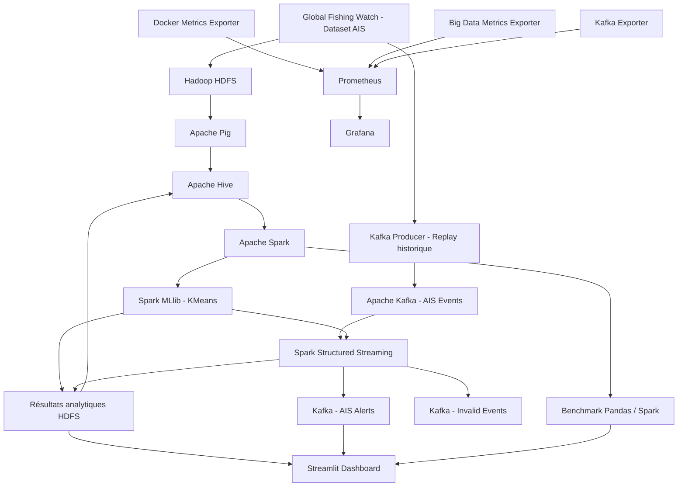
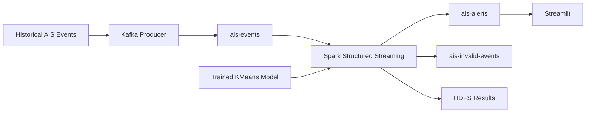
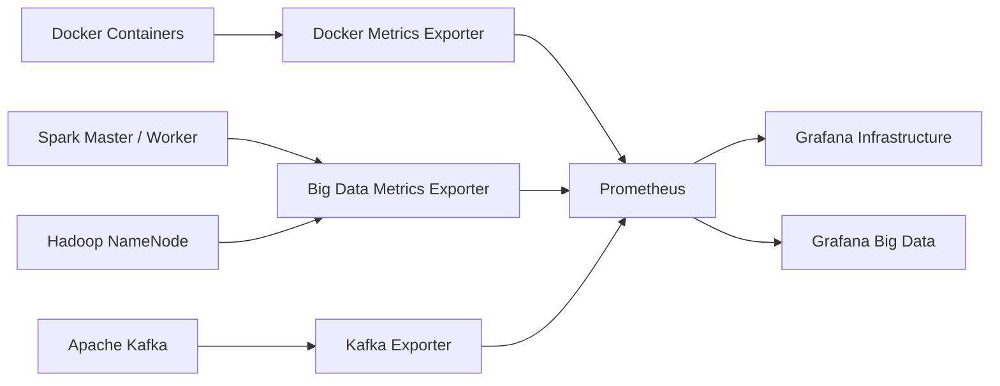

# DarkSea-AI — Maritime Intelligence Platform

**Big Data · Artificial Intelligence · Maritime Analytics · Streaming · Monitoring**

## 1. Présentation du projet

DarkSea-AI est une plateforme intelligente d'analyse maritime exploitant les technologies Big Data et le Machine Learning pour étudier les interruptions du signal AIS (Automatic Identification System) et identifier les comportements maritimes atypiques.

La plateforme transforme des données historiques brutes en connaissances exploitables, construit des profils comportementaux de navires et détecte des anomalies à travers une architecture intégrant le traitement batch, le traitement distribué, le streaming et la visualisation interactive.

## 2. Problématique

Comment exploiter efficacement de grands volumes de données maritimes afin d'identifier des comportements atypiques, de générer des alertes dynamiques et de faciliter la surveillance des activités maritimes ?

## 3. Objectifs

- Construire de nouvelles connaissances à partir des interruptions AIS.
- Exploiter conjointement Apache Pig, Apache Hive et Apache Spark.
- Identifier les profils de navires et les événements atypiques avec le Machine Learning.
- Simuler un flux maritime et générer des alertes dynamiques.
- Comparer les performances des traitements classiques et distribués.
- Étudier la consommation des ressources informatiques.
- Visualiser les résultats analytiques et superviser l'infrastructure.

## 4. Architecture globale



L'architecture distingue trois composantes principales :

- **Pipeline batch :** extraction de connaissances, analyse historique et entraînement des modèles.
- **Pipeline streaming :** simulation d'événements, inférence et génération d'alertes.
- **Supervision et évaluation :** benchmark, collecte des métriques et monitoring technique.

## 5. Technologies utilisées

| Technologie | Version | Rôle |
|---|---|---|
| Hadoop HDFS | 3.2.1 | Stockage distribué |
| Apache Pig | 0.17.0 | Extraction de connaissances |
| Apache Hive | 3.1.3 | Tables et requêtes analytiques |
| Apache Spark | 3.5.3 | Traitement parallèle et distribué |
| Spark MLlib | 3.5.3 | Machine Learning |
| Spark Structured Streaming | 3.5.3 | Traitement dynamique |
| Apache Kafka | 3.9.1 | Transport des événements et alertes |
| PostgreSQL | 15 | Métadonnées Hive |
| Pandas | 2.0.3 pour le benchmark | Référence de traitement classique |
| Streamlit | 1.45.1 | Dashboard métier |
| Plotly | 6.1.2 | Visualisation interactive |
| Prometheus | 3.5.0 | Collecte des métriques |
| Grafana | 12.1.0 | Supervision technique |
| Docker Compose | V2 | Orchestration des services |
| Pytest | — | Tests automatisés |
| Git / GitHub | — | Gestion des versions |

## 6. Dataset

**Source :** Global Fishing Watch

https://globalfishingwatch.org/

Le projet exploite un dataset historique d'événements d'interruption du signal AIS.

| Indicateur | Valeur |
|---|---:|
| Événements AIS | 55 368 |
| Navires distincts | 5 269 |
| Période historique | 2017–2019 |
| Nombre de variables initiales | 15 |
| Cellules géographiques | 994 |
| Pavillons représentés | 102 |
| Types de navires | 5 |
| Mois analysés | 36 |

Les variables comprennent notamment l'identifiant MMSI, le type de navire, le pavillon, les coordonnées géographiques, les timestamps et la durée des interruptions.

## 7. Extraction de connaissances avec Apache Pig

Apache Pig transforme les données brutes en nouvelles connaissances analytiques.

Les traitements permettent de construire :

- Les profils comportementaux des navires.
- Le nombre d'interruptions par navire.
- Les durées moyennes, maximales et cumulées.
- Les statistiques géographiques par cellule maritime.
- Les statistiques mensuelles.
- Les statistiques par pavillon et type de navire.
- Les catégories de distance par rapport aux côtes.
- Les indicateurs de qualité des données.

Ces résultats sont stockés dans HDFS et exploités par Hive et Spark.

## 8. Analyse avec Apache Hive

Apache Hive structure les connaissances produites par Pig et les résultats générés par Spark MLlib.

### Tables analytiques

| Table | Description |
|---|---|
| profils_navires | Profils comportementaux |
| profils_enrichis | Profils et indicateurs enrichis |
| statistiques_globales | Indicateurs globaux |
| navires_prioritaires | Navires sélectionnés par règles analytiques |
| profils_scores | Résultats du modèle KMeans |
| anomalies_ml | Profils atypiques |
| synthese_clusters | Statistiques des clusters |
| comparaison_regles_ml | Comparaison des règles et du Machine Learning |
| evenements_cartographie | Événements géolocalisés |
| zones_maritimes | Agrégations géographiques |
| statistiques_mensuelles | Analyse temporelle |
| statistiques_pavillons | Analyse par pavillon |
| statistiques_types_navires | Analyse par type de navire |
| statistiques_distance_cote | Analyse par distance aux côtes |

**Total : 14 tables Hive.**

## 9. Intelligence artificielle avec Spark MLlib

DarkSea-AI utilise deux modèles KMeans non supervisés, construits avec les algorithmes disponibles dans Spark MLlib.

### 9.1. Détection des profils de navires atypiques

Variables utilisées :

- Nombre d'interruptions.
- Durée moyenne des interruptions.
- Durée maximale des interruptions.

Pipeline :

Transformation logarithmique → VectorAssembler → StandardScaler → KMeans → Distance au centroïde → Détection des profils atypiques.

| Indicateur | Résultat |
|---|---:|
| Profils analysés | 5 269 |
| Nombre optimal de clusters | 2 |
| Silhouette de validation | 0,6639 |
| Silhouette de test | 0,6672 |
| Profils atypiques | 327 |
| Taux de profils atypiques | 6,21 % |
| Profils détectés uniquement par le ML par rapport aux règles Hive | 44 |

### 9.2. Détection des événements AIS atypiques

Variables utilisées :

- Durée de l'interruption.
- Distance par rapport aux côtes.
- Déplacement géographique apparent.
- Vitesse apparente.

La séparation chronologique des données permet de distinguer les ensembles d'entraînement, de validation et de test.

| Indicateur | Résultat |
|---|---:|
| Événements analysés | 55 368 |
| Nombre optimal de clusters | 3 |
| Silhouette de validation | 0,5165 |
| Silhouette de test | 0,4626 |
| Événements historiques atypiques | 2 742 |
| Taux d'événements atypiques | 4,95 % |
| Événements de test | 11 123 |

Les modèles sont sauvegardés dans HDFS et réutilisés lors de l'inférence.

Les scores d'anomalie reposent sur la distance aux centroïdes et sur des seuils statistiques déterminés à partir des données de validation.

## 10. Surveillance dynamique avec Apache Kafka

Le pipeline streaming simule l'arrivée progressive d'événements AIS historiques.



### Topics Kafka

| Topic | Fonction |
|---|---|
| ais-events | Événements AIS entrants |
| ais-alerts | Alertes générées |
| ais-invalid-events | Événements invalides |

Le traitement comprend la validation des événements, l'extraction des caractéristiques, l'inférence avec le modèle KMeans, la classification des alertes et la sauvegarde des résultats.

### Validation Batch / Streaming

| Indicateur | Résultat |
|---|---:|
| Événements rejoués | 11 123 |
| Débit configuré du producteur | 50 événements/s |
| Alertes statistiques | 547 |
| Alertes de cohérence physique | 4 |
| Total des alertes | 551 |
| Concordance Batch / Streaming | 100 % |
| Doublons observés dans ce test | 0 |
| Événements manquants | 0 |
| Différences de prédiction | 0 |
| Latence moyenne jusqu'au scoring | 7,71 s |
| Latence P50 | 5,79 s |
| Latence P95 | 21,44 s |
| Latence P99 | 28,90 s |
| Latence maximale | 31,14 s |

Un second test de 1 000 événements a permis de vérifier l'intégration du pipeline avec le dashboard et la génération de 45 alertes, sans événements manquants ni différences de prédiction.

### Optimisation expérimentale du streaming V1/V2

Le consommateur de production reste inchangé (`spark/jobs/07_streaming_consumer.py`). Les versions instrumentée V1 et optimisée V2 sont isolées dans `spark/benchmark/streaming/`. V2 regroupe les comptages et statistiques dans deux actions Spark explicites au lieu de huit, hors écritures, sans modifier le modèle KMeans.

Les deux pilotes complets (`pilot_v1_03`, `pilot_v2_01`) utilisent les mêmes 1 000 événements de test, un débit producteur de 50 événements/s, un trigger de 5 s, quatre partitions de shuffle et un maximum de 1 000 offsets par trigger. Chaque version dispose de son propre checkpoint et de ses résultats HDFS. Les topics de benchmark sont `ais-benchmark-events`, `ais-benchmark-alerts` et `ais-benchmark-invalid`.

| Indicateur | V1 | V2 |
|---|---:|---:|
| Actions explicites hors écritures | 8 | 2 |
| Événements traités | 1 000 | 1 000 |
| Alertes reçues et uniques | 45 | 45 |
| Événements invalides | 0 | 0 |
| Latence moyenne de bout en bout | 87,053 s | 41,401 s |
| P50 | 89,636 s | 41,175 s |
| P95 | 95,651 s | 47,483 s |
| P99 | 96,251 s | 49,236 s |
| Temps cumulé des micro-batches non vides | 99,143 s | 47,254 s |

Le gain pilote est de 52,44 % sur la latence moyenne et de 75 % sur le nombre d'actions explicites. La latence de bout en bout est mesurée entre l'horodatage d'ingestion du producteur et la réception de l'alerte par l'observateur Kafka ; elle ne doit pas être confondue avec la latence jusqu'au scoring du test de production précédent.

La validation compare Batch/V1, Batch/V2 et V1/V2 sur 1 000 événements chacune : aucun événement manquant, aucun doublon, aucune différence de cluster, de score ou d'anomalie. Les types d'alertes et règles physiques concordent entre V1 et V2. L'écart maximal des scores est nul (tolérance 1e-6).

[Rapport JSON de validation du pilote](spark/benchmark/streaming/results/validation_pilot_v1_03_vs_pilot_v2_01.json).

Ces résultats proviennent d'une seule exécution complète par version ; ils ne démontrent ni un débit soutenu de 50 événements/s ni un gain généralisable. Les répétitions sur le jeu complet restent à réaliser. Le trigger de 5 s est conservé ; les autres triggers ne sont pas nécessaires à la finalisation.

## 11. Dashboard métier Streamlit

Le dashboard comporte sept pages interactives.

| Page | Fonctionnalités |
|---|---|
| Vue d'ensemble | Indicateurs globaux et statistiques maritimes |
| Cartographie | Visualisation géographique et filtres |
| Navires | Profils comportementaux et analyse individuelle |
| Intelligence artificielle | Clusters, anomalies et métriques des modèles |
| Surveillance dynamique | Alertes Kafka, journal et suivi de la latence |
| Benchmark performance | Comparaison des moteurs de traitement |
| Analyse mémoire | Comparaison des pics mémoire, répétitions et consommation des ressources |

Les pages historiques utilisent des exports analytiques issus de HDFS. La page de surveillance dynamique consomme les alertes Kafka.

## 12. Benchmark des performances Big Data

Le benchmark compare trois moteurs :

- Pandas.
- Spark Local avec deux threads d'exécution.
- Spark Standalone avec un worker et deux cœurs alloués.

Les moteurs réalisent une même agrégation métier sur les mêmes fichiers Parquet.

### Volumes expérimentaux

| Facteur | Nombre de lignes |
|---|---:|
| ×1 | 55 368 |
| ×10 | 553 680 |
| ×50 | 2 768 400 |
| ×100 | 5 536 800 |

Les volumes supérieurs au dataset initial sont générés par duplication contrôlée des événements avec des identifiants uniques.

### Résultats — temps médians en secondes

| Volume | Pandas | Spark Local | Spark Standalone |
|---|---:|---:|---:|
| ×1 | 0,473 | 2,557 | 2,483 |
| ×10 | 0,274 | 1,741 | 1,811 |
| ×50 | 2,572 | 3,830 | 3,615 |
| ×100 | 1,914 | 3,125 | 3,693 |

### Validation expérimentale

- 36 exécutions.
- 12 configurations.
- 3 répétitions par configuration.
- Concordance numérique de 100 % entre les moteurs selon les tolérances définies.
- Comparaison du temps d'exécution, du débit et du speedup.

Dans l'environnement expérimental actuel, Pandas présente les meilleurs temps d'exécution. Spark introduit un coût lié à la JVM, à la planification et à l'exécution distribuée.

Le cluster étant déployé sur une seule machine physique, ces résultats ne permettent pas de conclure sur les performances d'un cluster multi-machines.

## 13. Benchmark mémoire

**Statut : expérimentation terminée et résultats validés.**

Le benchmark mémoire compare Pandas, Spark Local et Spark Standalone sur quatre volumes de données, avec trois répétitions par configuration.

### Méthodologie

- Mesures Linux cgroup v2 working set.
- Échantillonnage à un intervalle cible de 100 ms.
- Collecte simultanée sur Spark Master et Spark Worker.
- Synchronisation temporelle des mesures.
- Mémoire de référence calculée sur cinq secondes.
- Nouvelle application pour chaque exécution.
- Ordre d'exécution pseudo-aléatoire reproductible.

### Résultats — pic mémoire supplémentaire médian (Mio)

| Volume | Pandas | Spark Local | Spark Standalone |
|---|---:|---:|---:|
| ×1 | 53,26 | 616,04 | 1 008,79 |
| ×10 | 100,75 | 574,60 | 1 016,65 |
| ×50 | 234,81 | 623,12 | 952,95 |
| ×100 | 372,59 | 594,59 | 948,44 |

### Validation

- 36 exécutions réussies.
- 12 configurations expérimentales.
- 80 228 232 lignes traitées cumulées.
- 5 269 profils générés par exécution.
- Concordance numérique de 100 % selon les tolérances définies.
- 11 tests unitaires de synthèse et de validation réussis.

Pandas présente la consommation mémoire la plus faible sur les volumes étudiés. Cependant, son pic mémoire supplémentaire est multiplié par environ sept entre les volumes ×1 et ×100.

Spark présente une empreinte mémoire plus importante, mais relativement stable sur les volumes étudiés.

Ces observations illustrent le comportement des moteurs face à l'augmentation du volume de données, sans démontrer une supériorité générale de Spark.

Les mesures incluent le démarrage et l'arrêt des applications. Elles concernent une agrégation analytique sur une seule machine physique, avec des données synthétiquement agrandies et un nombre de groupes constant.

Les résultats sont disponibles sous forme de synthèses JSON et CSV.

## 14. Monitoring et observabilité

DarkSea-AI dispose d'une infrastructure de supervision fondée sur Prometheus et Grafana.



### Docker Metrics Exporter

Exporteur personnalisé permettant de collecter :

- Utilisation CPU.
- Consommation mémoire.
- Trafic réseau.
- Entrées et sorties disque.
- Nombre de processus.
- État de la collecte.

### Big Data Metrics Exporter

Exporteur personnalisé permettant de superviser :

- Spark Master et Spark Worker.
- Applications Spark.
- Exécuteurs et ressources allouées.
- Capacité et utilisation HDFS.
- DataNodes et blocs HDFS.
- Disponibilité des services et durée de collecte.

### Dashboards Grafana

| Dashboard | Nombre de panneaux |
|---|---:|
| DarkSea Infrastructure | 24 |
| DarkSea Big Data | 28 |
| Total | 52 |

Prometheus supervise également la disponibilité des exporteurs et collecte les métriques Kafka.

## 15. Organisation du dépôt

```text
DarkSea-AI/
├── docker/
│   ├── docker-compose.yml
│   ├── hive/
│   ├── pig/
│   └── spark/
├── pig/
│   ├── test_lecture.pig
│   ├── profil_navires.pig
│   └── enrichissement_maritime.pig
├── hive/
│   └── Scripts SQL analytiques
├── spark/
│   ├── jobs/
│   ├── results/
│   └── benchmark/
│       ├── results/
│       ├── tests/
│       └── streaming/
│           ├── consumer_v1_instrumented.py
│           ├── consumer_v2.py
│           ├── batch_metrics.py
│           ├── alert_observer.py
│           ├── validate_benchmark.py
│           ├── tests/
│           └── results/
├── streaming/
│   └── producer/
├── dashboard/
│   ├── app.py
│   ├── pages/
│   ├── services/
│   ├── components/
│   ├── assets/
│   ├── data/
│   └── tests/
├── monitoring/
│   ├── docker-exporter/
│   ├── bigdata-exporter/
│   ├── prometheus/
│   ├── grafana/
│   ├── docker-compose.monitoring.yml
│   └── docker-compose.bigdata.yml
├── .gitignore
└── README.md
```

## 16. Installation et démarrage

### Prérequis

- Git.
- Docker Desktop avec Docker Compose.
- WSL2 pour un environnement Windows.
- Python 3.11 pour le dashboard.
- Mémoire RAM suffisante pour exécuter les services Big Data.

### Cloner le projet

```bash
git clone https://github.com/Yosr03/DarkSea-AI.git
cd DarkSea-AI
```

### Démarrer l'infrastructure Big Data

```bash
docker compose -f docker/docker-compose.yml up -d --build
```

Vérifier les conteneurs :

```bash
docker ps
```

### Préparer les données

Le dataset source doit être récupéré auprès de Global Fishing Watch et placé dans :

```text
data/raw/ais_disabling_events.csv
```

Les données doivent ensuite être importées dans HDFS.

L'exécution complète nécessite la préparation des répertoires HDFS, l'initialisation du metastore Hive, l'exécution des scripts Pig et Hive, l'entraînement des modèles Spark et la génération des exports analytiques.

Les instructions de reproduction détaillées de ces étapes restent à finaliser.

### Démarrer le monitoring

```bash
docker compose -f monitoring/docker-compose.monitoring.yml -f monitoring/docker-compose.bigdata.yml up -d --build
```

### Démarrer Streamlit sous Windows

```powershell
py -3.11 -m venv .venv-dashboard

.\.venv-dashboard\Scripts\Activate.ps1

python -m pip install -r dashboard/requirements.txt

Set-Location dashboard

python -m streamlit run app.py
```

Les exports historiques et les métriques doivent être générés avant l'utilisation complète du dashboard.

### Reproduire le benchmark streaming (PowerShell)

Prérequis : modèle événementiel et résultats batch disponibles dans HDFS, fichier `streaming/data/ais_events.csv` préparé, topics de benchmark créés (trois partitions chacun), répertoire HDFS `/darksea/benchmark/streaming` accessible en écriture à Spark et aucun autre consommateur benchmark actif. Utiliser un nom de run inédit pour chaque expérience.

Terminal 1 (V2 ; pour V1 remplacer le script par `consumer_v1_instrumented.py` et choisir un autre nom de run) :

```powershell
docker exec -it darksea-spark-master /opt/spark/bin/spark-submit `
    --master spark://spark-master:7077 --deploy-mode client `
    --driver-memory 1g --executor-memory 1g `
    --executor-cores 2 --total-executor-cores 2 `
    --conf spark.driver.host=spark-master `
    --conf spark.driver.bindAddress=0.0.0.0 `
    --conf spark.jars.ivy=/home/spark/.ivy2 `
    --repositories https://repo.maven.apache.org/maven2 `
    --packages org.apache.spark:spark-sql-kafka-0-10_2.12:3.5.3 `
    --py-files /workspace/spark/jobs/event_features.py `
    /workspace/spark/benchmark/streaming/consumer_v2.py `
    --run-name replay_v2_01 --trigger 5 --max-offsets 1000 --shuffle-partitions 4
```

Attendre `SPARK BENCHMARK READY`, puis lancer dans le terminal 2 (environnement dashboard activé) :

```powershell
python .\spark\benchmark\streaming\alert_observer.py --run-name replay_v2_01 --timeout 600
```

Attendre `OBSERVER READY`, vérifier que les offsets initiaux du checkpoint correspondent aux offsets Kafka courants, puis lancer dans le terminal 3 :

```powershell
python .\streaming\producer\ais_benchmark_producer.py --limit 1000 --rate 50
```

Attendre 1 000 événements traités et 45 alertes reçues, vérifier les commits HDFS et arrêter proprement le consommateur et l'observateur avant toute nouvelle expérience. Les métriques et alertes observées sont enregistrées dans `spark/benchmark/streaming/results/<run-name>/`. Noter les identifiants de replay affichés par le producteur.

Pour valider les deux pilotes historiques (si leurs résultats HDFS sont toujours présents) :

```powershell
docker exec -it darksea-spark-master /opt/spark/bin/spark-submit `
    --master spark://spark-master:7077 --deploy-mode client `
    --driver-memory 1g --executor-memory 1g `
    --executor-cores 2 --total-executor-cores 2 `
    --conf spark.driver.host=spark-master `
    --conf spark.driver.bindAddress=0.0.0.0 `
    /workspace/spark/benchmark/streaming/validate_benchmark.py `
    --run-v1 pilot_v1_03 --run-v2 pilot_v2_01 `
    --replay-v1 5f4fdb37-2621-4fc9-8821-78f1f6ff2678 `
    --replay-v2 e74d2ad1-068b-45c4-a800-742a1fd228ca `
    --limit 1000 --expected-alerts 45
```

Pour de nouveaux runs, adapter les noms et identifiants de replay. Les résultats HDFS historiques ne sont pas inclus dans Git.

### Interfaces locales

| Interface | URL |
|---|---|
| Streamlit | http://localhost:8501 |
| Grafana | http://localhost:3000 |
| Prometheus | http://localhost:9090 |
| Hadoop NameNode | http://localhost:9870 |
| Spark Master | http://localhost:8081 |
| Spark Worker | http://localhost:8082 |
| HiveServer2 Web UI | http://localhost:10002 |

## 17. Tests et validation

Le projet comporte des tests automatisés et des validations fonctionnelles.

| Composante | Validation |
|---|---|
| Pipeline Pig / Hive | Contrôle des agrégations |
| Modèles KMeans | Rechargement et concordance des prédictions |
| Batch / Streaming | Comparaison des événements et scores |
| Dashboard historique | 22 tests unitaires réussis |
| Service Kafka | 11 tests unitaires réussis |
| Service benchmark | 8 tests unitaires réussis |
| Comparateur benchmark | 6 tests réussis |
| Big Data Metrics Exporter | 19 tests unitaires réussis |

Les suites de tests sont disponibles dans les répertoires correspondants. Les imports des deux exporters sont isolés et leurs fichiers de tests portent des noms distincts.

Depuis la racine du dépôt, dans l'environnement Python 3.11 du dashboard :

```powershell
python -m pip install -r dashboard/requirements.txt
python -m pip install -r monitoring/bigdata-exporter/requirements.txt
python -m pip install -r monitoring/docker-exporter/requirements.txt
python -m pip check
python -m pytest -q
```

Dernière exécution globale validée : **127 tests réussis en 6,15 secondes**, sans erreur de collecte. Le nouveau validateur streaming a également été exécuté avec succès sur les résultats HDFS des deux pilotes ; ses tests unitaires spécifiques restent à compléter.

## 18. État d'avancement

- [x] Infrastructure Hadoop, Pig, Hive et Spark
- [x] Extraction de nouvelles connaissances avec Pig
- [x] Construction des tables analytiques Hive
- [x] Entraînement des deux modèles KMeans
- [x] Validation des modèles
- [x] Intégration Apache Kafka
- [x] Spark Structured Streaming
- [x] Validation Batch / Streaming
- [x] Dashboard métier Streamlit
- [x] Benchmark Pandas / Spark
- [x] Monitoring Prometheus et Grafana
- [x] Docker Metrics Exporter
- [x] Big Data Metrics Exporter
- [x] Finalisation du benchmark mémoire
- [x] Optimisation streaming V2 et validation du pilote
- [x] Validation globale des 127 tests
- [ ] Benchmark streaming complet avec répétitions
- [ ] Synthèse et visualisation comparative V1/V2
- [ ] Tests de robustesse et de récupération
- [ ] Renforcement de la sécurité
- [ ] Documentation complète de reproductibilité

## 19. Limites scientifiques et techniques

- Les anomalies détectées constituent des signaux à examiner et non des preuves d'activités maritimes illégales.
- Le dataset ne fournit pas de vérité terrain permettant de mesurer directement la précision de la détection.
- Le coefficient de silhouette évalue la structure des clusters et non la précision de classification des anomalies.
- Le streaming repose sur un replay historique et non sur un flux AIS maritime en direct.
- Le cluster est déployé sur une seule machine physique.
- Les volumes expérimentaux agrandis sont synthétiques.
- Les benchmarks portent sur une agrégation analytique et ne mesurent pas directement les performances de l'entraînement MLlib.
- Le gain de latence streaming V2 est un résultat pilote ; la latence reste élevée et les répétitions sont nécessaires.
- La configuration actuelle ne garantit pas la haute disponibilité.
- Les alertes Kafka nécessitent une stratégie de déduplication ; les écritures HDFS et Kafka ne constituent pas une transaction atomique.
- Les exporteurs et services sont destinés à un environnement local de développement. L'accès au socket Docker présente des risques de sécurité.

Les datasets bruts, les modèles générés, les checkpoints et certains exports analytiques ne sont pas inclus dans le dépôt Git.

## 20. Perspectives

- Consolider les gains streaming V1/V2 par des répétitions sur le jeu de test complet.
- Intégrer la synthèse du benchmark streaming dans le dashboard.
- Tester la récupération après interruption des services.
- Améliorer la reproductibilité du déploiement.
- Renforcer la sécurité de l'infrastructure.
- Étudier les performances sur un véritable cluster multi-machines.
- Intégrer, à terme, des sources AIS actualisées.

## 21. Contexte académique

Projet de Big Data Avancé réalisé en équipe de trois étudiants.

DarkSea-AI illustre l'intégration des technologies Big Data au service de l'intelligence artificielle, à travers un cas d'application concret d'analyse et de surveillance maritime.
